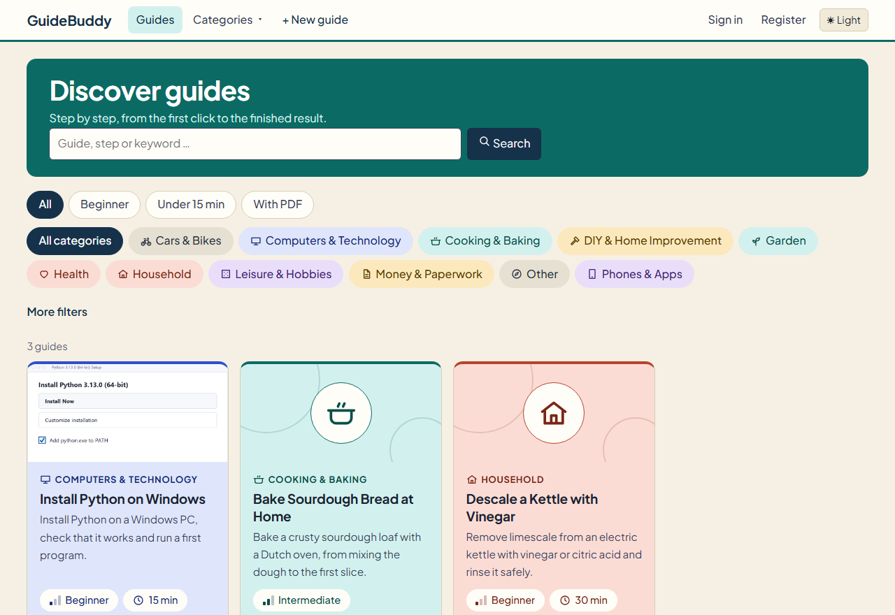
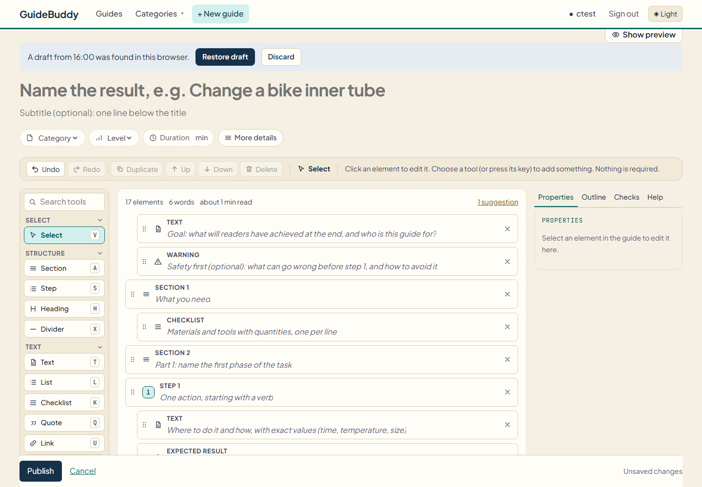
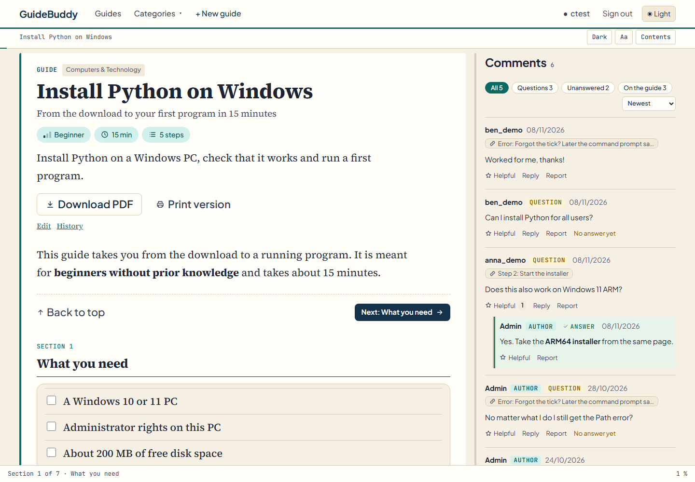
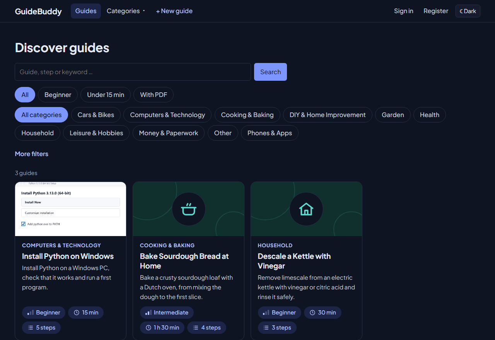
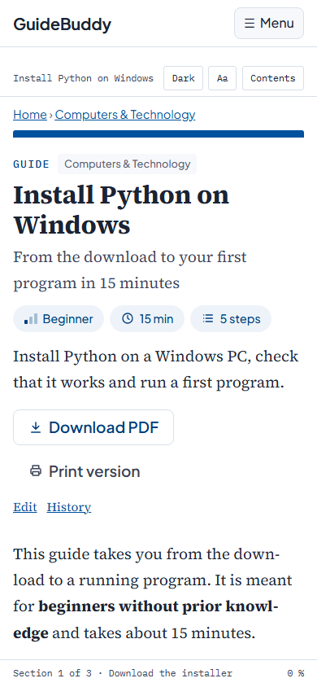

# GuideBuddy

A platform for step-by-step guides: everyone can read them without an account, signed-in users write them with a builder that works like a drawing tool, and every guide can be downloaded as PDF.

> **Status:** in active development. Features and the look can change.




## Features

- **Read without an account:** overview with search and filters (level, duration, category, "with PDF"), pages rendered on the server, light and dark mode, text size, reading progress and a "Next section" link at the end of each section.
- **Guides are lists of elements:** 24 kinds, such as sections, numbered steps readers can tick off, checklists, tables, images, diagrams and code. One fixed template renders them, so authors never choose colours or fonts ([elements and fields](docs/guide-types.md)).
- **A builder like a drawing tool:** it starts from a blank page, with tool search, undo and redo, duplicate, an outline and a live preview. A draft is kept in the browser while writing.
- **Help for good guides:** a how-to template (goal, materials, steps with results, outcome, troubleshooting) and ten suggestions before publishing. They only advise and never block.
- **Notices with a fixed meaning:** Important, Warning, Danger, Error, Tip, Note and Expected result, each with an icon and a word, so colour is never the only signal.
- **Comments:** on the whole guide or on one element, as feedback, question, error or addition, with replies, a marked answer, "Helpful" votes, sorting, reports and community rules. Moderators hide a comment with a visible reason.
- **Trust and status:** every guide shows its status (published, outdated, archived), version, author, contributors and dates. Readers can report a guide as outdated, and authors archive a guide instead of deleting it.
- **Finding guides:** search suggestions with a hint after a typo, related guides on every guide and a short hint for first-time visitors.
- **PDF and attachments:** PDF download (with a fallback when WeasyPrint is missing) and one attachment per guide with an inline preview.
- **Accounts and moderation:** e-mail confirmation, password reset, edit history, report, hide comments, lock and ban.
- **Security:** JWT in HttpOnly cookies with token rotation, spam protection (honeypot, rate limits, waiting period for new accounts, optional Cloudflare Turnstile) and sanitized Markdown.
- **Accessible colours:** the main colour pairs reach WCAG AA in both modes (`python scripts/check_contrast.py`), and movement is switched off for people who ask for reduced motion.
- **English only:** interface, sample data and legal pages (templates for an operator in Germany).

## Screenshots

<table>
  <tr>
    <td width="50%"><br><sub><b>Reading view:</b> the start of a guide</sub></td>
    <td width="50%"><br><sub><b>Warning first:</b> safety notice before step 1</sub></td>
  </tr>
  <tr>
    <td width="50%"><br><sub><b>Builder:</b> tools, edit buttons, outline and checks</sub></td>
    <td width="50%"><br><sub><b>Template:</b> the parts of a how-to guide as empty parts with hints</sub></td>
  </tr>
  <tr>
    <td width="50%"><br><sub><b>Comments:</b> questions on single elements, a marked answer</sub></td>
    <td width="50%"><br><sub><b>Dark mode:</b> the overview</sub></td>
  </tr>
</table>

**On a phone**

<table>
  <tr>
    <td><br><sub>Reading view</sub></td>
    <td><br><sub>Table as cards</sub></td>
    <td><br><sub>Comments</sub></td>
    <td><br><sub>Builder</sub></td>
  </tr>
</table>

## Requirements

- Python 3.13 (3.12 or newer)
- Node.js 22 LTS and npm
- Optional for the best PDF output: GTK/Pango (needed by WeasyPrint, often missing on Windows)

All packages are listed in [docs/dependencies.md](docs/dependencies.md).

## Quick start

Backend:

```bash
python -m venv .venv
# Windows: .venv\Scripts\activate
# Linux and macOS: source .venv/bin/activate
pip install -r requirements.txt
python manage.py migrate
python manage.py seed_samples   # three sample guides (the categories come with the migrations)
python manage.py createsuperuser
python manage.py runserver
```

Frontend, in a second terminal:

```bash
cd frontend
npm install
npm run dev
```

Open `http://localhost:3000`. On Windows, `start-dev.ps1` starts both servers in one step and uses the next free port if 8000 or 3000 is taken:

```bash
powershell -ExecutionPolicy Bypass -File .\start-dev.ps1
```

No mail server is needed in development: confirmation and password-reset e-mails are printed to the terminal where `runserver` is running.

## Usage

1. Register on the site and open the confirmation link from the `runserver` terminal.
2. Choose **New guide**, start from a blank page or from the how-to template, and add elements with the tools on the left.
3. Press **Publish**. Anyone can now read the guide, comment on it and download it as PDF.

To make someone a moderator, open the admin at `http://127.0.0.1:8000/admin/` and add the user to the group "Moderatoren" (superusers are moderators automatically).

## Tests and checks

```bash
python manage.py test           # backend, takes a few minutes
python scripts/check_contrast.py
cd frontend
npm test
npm run typecheck
npm run build
```

What is tested, and what is not: [docs/tests.md](docs/tests.md).

## Documentation

- [Elements and their fields](docs/guide-types.md): the contract between builder, API and templates
- [Architecture](docs/architecture.md): browser, Nuxt and Django, and how login works
- [Production](docs/production.md): deployment and regular jobs
- [Dependencies](docs/dependencies.md): Python and Node packages
- [Tests](docs/tests.md): what the tests cover and how to add one
- [Project structure](docs/project-structure.md): where things are

## Contributing and support

Questions, bug reports and ideas: [open an issue](https://github.com/TranceMeli/GuideBuddy/issues). Before a change, run the tests and the checks above. For larger changes, open an issue first so we can agree on the approach.

## License

Guides are published under [CC BY-SA 4.0](https://creativecommons.org/licenses/by-sa/4.0/). The source code has no license yet, so all rights are reserved for now.
