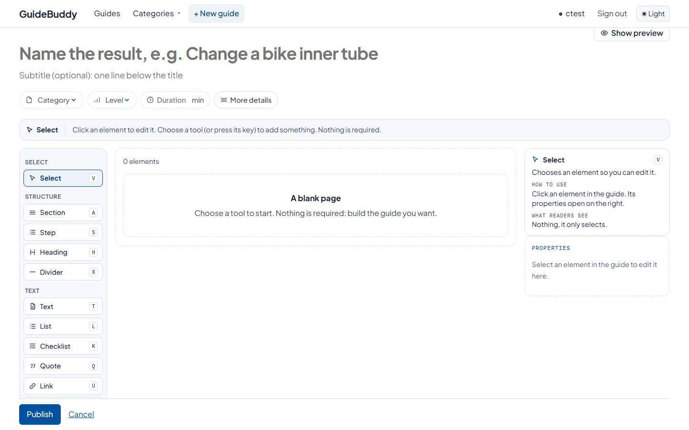
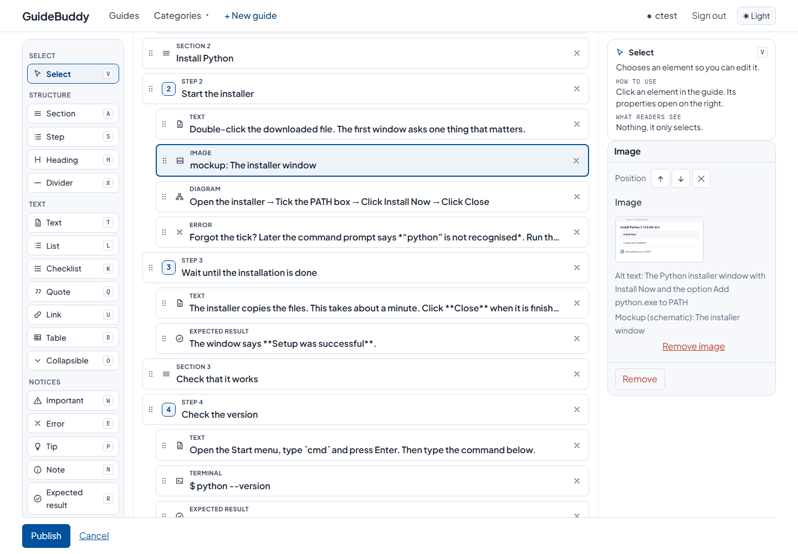
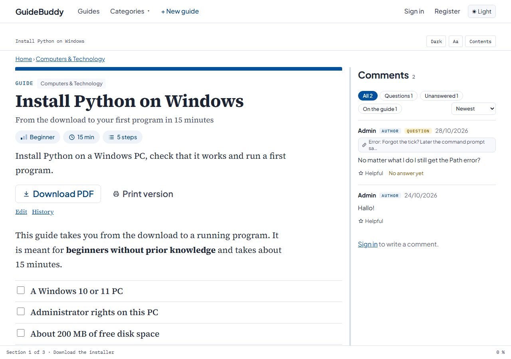
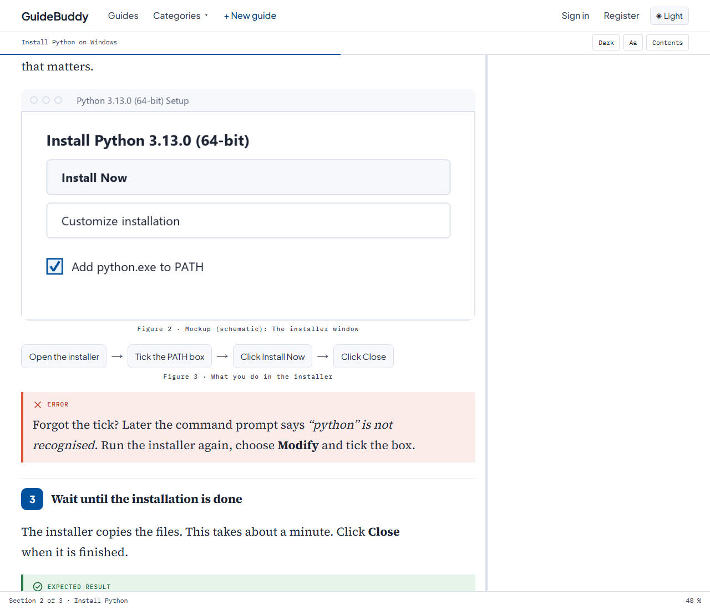
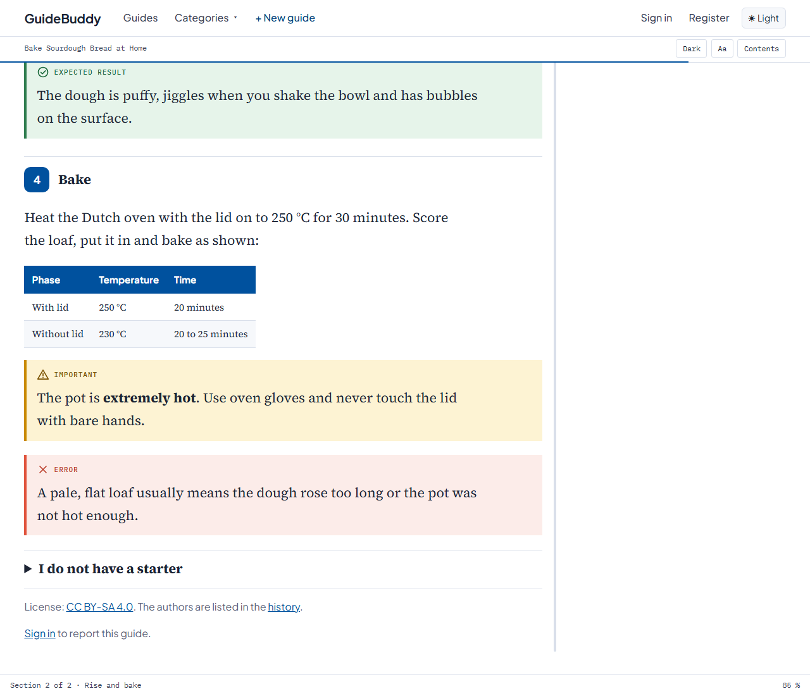
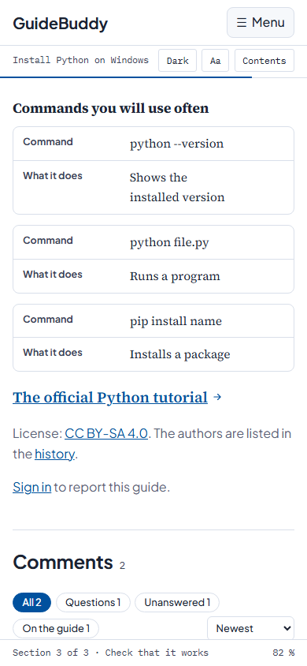
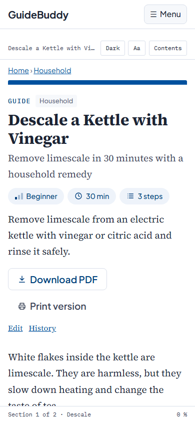
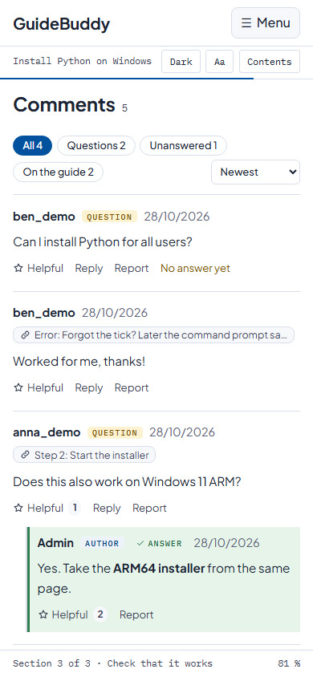
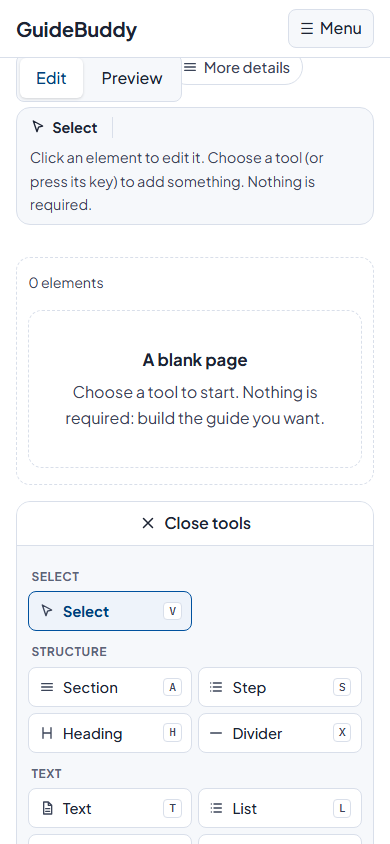

# GuideBuddy

A Wikipedia-style platform for guides on any topic, built from elements with a design-tool style guide builder. Guides can be read without an account, edited by the community, and downloaded as PDF.


More pictures: [Screenshots](#screenshots).

## Features

- Public reading, full-text search and categories, server-side rendered for SEO and accessibility
- Single sourcing: a guide is a list of typed elements, rendered by one fixed template; authors never choose colors, fonts or layout ([elements and fields](docs/guide-types.md))
- One kind of guide in the editor: an ordered list of elements built with tools (stored as type `page`), plus a way to publish a finished file or text (`/guides/new?file=1`, type `free`). Reading view: sections, numbered steps readers can tick off, text, lists, checklists, quotes, links, tables, collapsibles, notices, images, diagrams, terminal and code blocks, wrong-and-right examples and download buttons
- Overview as cards (level, duration, step count) with filters by level, duration, category and "with PDF"; a guide without a cover image gets a placeholder illustration for its category (bike, monitor, pot, sprout …) on one of three tints, or one picked from its slug when it has no category, so neighbouring cards differ
- Images uploaded separately with required alt text, referenced from image elements
- Editor that looks like the finished guide: big title, level, duration and category as chips, optional fields folded under "More details"
- Guide builder laid out like a design tool, starting from a blank page with nothing required: 22 tools on the left in groups (Structure, Text, Notices, Media), the options of the chosen tool on top, the guide as cards in the middle, and on the right a help card (what the tool does, how to use it, what readers see) above the properties of the selected element. A tool is chosen by click or key (shown next to it; Esc returns to Select) and placed by clicking "Place here" between the cards; dragging a tool onto the guide works too. Empty elements show a placeholder in the guide and in the live preview, which opens with "Show preview" on wide screens. On phones the tools are a "Tools" sheet and the properties replace the guide while an element is selected. A short "Before you publish" list advises (descriptive headings, steps with content, an expected result, meaningful link texts) and never blocks publishing
- Text styles: authors can colour text (5 colours), highlight it (4 highlights) and choose a font (serif, handwriting, code style) from a fixed palette – in the rich text editor of free guides and, through a small formatting bar (bold, italic, code, list, link and the same styles), in every Markdown field. Content only stores class names (`c-teal`, `h-yellow`, `f-hand`), never colours or font names; the server keeps exactly these names. The standard look shows colours, highlights and fonts (lighter variants in dark mode). The fonts are loaded only by guides that use them
- Status colours with a fixed meaning: yellow = Important (`important`), red = Error (`error`), green = Expected result (`result`), blue = Tip and Note; each box has an icon and a word. Output lines of terminal blocks (code fences with `console` and a `$` prompt) are coloured by meaning (error, warning, success)
- Reading bars: a slim bar under the site header (title, Dark, Aa with text size, Contents) with a progress line, and a status bar at the bottom (section x of y, percent)
- Forgiving editors: removing a part never asks first – it is removed at once and an "Undo" button brings it back for a few seconds. Leaving the editor with unsaved changes asks first, closing the tab shows the browser warning, and "Unsaved changes" appears next to Publish
- Live preview while writing: editor on the left, the real reading template on the right with a draggable divider (mouse, touch or arrow keys; double-click resets; the width is remembered per browser) and a switch on phones; Markdown is rendered and sanitized by the server (`POST /api/markdown/render/`, no database access). A full server-side preview endpoint per guide also exists (saved in a savepoint and rolled back)
- Cover image per guide (`cover_image_id`), chosen from the guide's uploaded images
- Deleting guides (`DELETE /api/guides/<slug>/`): only the author and moderators, locked guides only moderators; files are removed, the history records stay so an admin can restore a guide
- One public attachment per guide (PDF, image, Office document, Markdown, text, CSV; 10 MB maximum), shown inline: PDFs and images in the browser, Word/Markdown/text/CSV as a sanitized preview
- Markdown content sanitized with nh3; authenticated users can write and edit Markdown comments, with revisions recorded
- Comments on the whole guide or on one element: every element in the reading view has a small bubble (with the number of comments) that opens the comments filtered to that place; the composer has an "About" list of the guide's elements, and the comment keeps the element's name ("Step 2: Start the installer") even if the element is deleted later. Replies one level deep, kind Comment or Question, "Helpful" votes (one per person, not for one's own comment, sort by most helpful), an answer marked on a question (by the asker, the guide author or a moderator; one per question, highlighted), filters (All, Questions, Unanswered, On the guide), and a report button per comment that moderators see with the comment text
- Edit history per guide, element and step of a free guide (django-simple-history)
- PDF download, with an automatic fallback when WeasyPrint is unavailable
- Accounts with e-mail confirmation, password reset and account deletion
- Roles and moderation: moderator group, report button, locking of guides, banning of accounts
- Spam protection: honeypot field, per-IP rate limits, waiting period for new accounts, optional Cloudflare Turnstile
- Secure login: JWT access and refresh tokens in HttpOnly cookies, never exposed to JavaScript; refresh token rotation with a blocklist, silent renewal, immediate revocation on password change, ban and logout
- English only: interface, reading templates, sample data and legal pages. Every guide still carries a language tag (`language`, always `en` for now, used as the `lang` attribute), so more languages can be added later without changing the API
- Top navigation (guides, categories menu, new guide, account) with a mobile menu, and a footer with the operator's address
- Reading view with a draggable divider between the guide and the comments
- One look: serif text, a narrow column of about 60 characters, taller lines, one blue accent, hairline rules and small mono labels, calm long reading; light, dark and automatic mode
- Images carry an optional caption and kind (Photo, Screenshot, Mockup (schematic), Diagram) that readers see in a numbered caption, so a drawn interface is never passed off as a screenshot; every image in guide text can be enlarged (click, tap or Enter; Esc closes)
- Tables in guide text turn into one small card per row on phones, with the column name in front of every cell, instead of scrolling sideways
- Legal pages (imprint, privacy, terms) as English templates for an operator based in Germany; old German page addresses (`/anmelden`, `/guides/<slug>/bearbeiten` …) and the former German guide slugs redirect permanently to the English ones
- Operations: SQLite in WAL mode, backup command, cleanup of unconfirmed accounts, deploy checks

## Architecture

```text
Browser  ->  Nuxt (port 3000)  ->  Django + DRF (port 8000)  ->  SQLite
             serves pages and      checks token, roles,
             forwards /api/...     rate limits
             and adds the token
             from the cookie
```

The browser only talks to Nuxt. The Nuxt server forwards `/api/...` requests to Django and attaches the access token from the HttpOnly cookie `gb_access` as `Authorization: Bearer`. Write requests from foreign origins are rejected (origin check plus `SameSite=Lax`).

### Authentication

- **Login** returns a short-lived access JWT (default 10 minutes) and a refresh JWT (default 14 days). The Nuxt server stores both in HttpOnly cookies (`gb_access`, `gb_refresh`, `SameSite=Lax`, `Secure` with https). The browser never sees the tokens, not even in a response body.
- **Silent renewal:** a Nuxt server middleware exchanges the refresh token for a new pair whenever the access cookie has expired. Parallel requests share one renewal.
- **Rotation:** every refresh issues a new refresh token and blocklists the old one (django-rest-framework-simplejwt blacklist).
- **Revocation:** logout blocklists the refresh token. A password change, password reset or ban invalidates all existing tokens at once (the access token carries a hash of the password, inactive accounts are rejected).
- **Public pages** stay readable even with an expired or revoked token; only write requests return 401.

The older Django-template frontend (HTMX) still runs on port 8000 and follows the same permission rules. It can be removed later.

## Requirements

- Python 3.13 (3.12 or newer)
- Node.js 22 LTS and npm
- Optional for the best PDF output: GTK/Pango (needed by WeasyPrint, often missing on Windows)

### Python packages

Installed with `pip install -r requirements.txt`:

| Package | Version | Purpose |
|---|---|---|
| Django | 6.1.1 | Web framework |
| djangorestframework | 3.18.1 | REST API |
| djangorestframework-simplejwt | 5.5.1 | JWT authentication with token blacklist (installs PyJWT) |
| django-cors-headers | 4.9.0 | CORS for local development |
| django-simple-history | 3.13.0 | Edit history |
| Markdown | 3.11 | Markdown rendering |
| mammoth | 1.13.0 | Word (.docx) attachment previews |
| Pygments | 2.19.2 | Syntax highlighting for fenced code blocks |
| nh3 | 0.3.7 | HTML sanitizing |
| weasyprint | 70.0 | PDF export (preferred) |
| xhtml2pdf | 0.2.21 | PDF export (fallback, pure Python) |
| whitenoise | 6.12.0 | Static files in production |
| gunicorn | 26.2.0 | Production server (Linux only, `requirements-prod.txt`) |

### Node packages

Installed with `npm install` in `frontend/`:

| Package | Version | Purpose |
|---|---|---|
| nuxt | ^4.5.2 | Frontend framework with server-side rendering |
| vue | ^3.5.43 | UI library |
| vue-router | ^5.3.1 | Routing |
| @tiptap/vue-3, @tiptap/starter-kit, @tiptap/pm, @tiptap/extension-table, @tiptap/extensions | 3.31.4 | Rich-text editor of the free guide |
| turndown, turndown-plugin-gfm | 7.2.4, 1.0.2 | Converts the editor's HTML to Markdown |
| @fontsource-variable/plus-jakarta-sans, @fontsource-variable/jetbrains-mono, @fontsource-variable/source-serif-4, @fontsource-variable/caveat, @fontsource/ibm-plex-mono | 5.x | Self-hosted fonts (no requests to Google): interface, code, reading text, handwriting style, small labels |
| typescript | ^5.9.3 | Types (dev) |
| vue-tsc | ^3.3.12 | Type checking (dev) |

## Getting started

### 1. Backend

```bash
python -m venv .venv
# Windows: .venv\Scripts\activate
# Linux and macOS: source .venv/bin/activate
pip install -r requirements.txt
python manage.py migrate
python manage.py seed_demo
python manage.py seed_samples   # three sample guides (Install Python, sourdough bread, descaling a kettle)
python manage.py createsuperuser
python manage.py runserver
```

`migrate` also creates the group "Moderatoren". To make someone a moderator, open the admin at `http://127.0.0.1:8000/admin/` and add the user to that group (superusers are moderators automatically).

### 2. Frontend

In a second terminal:

```bash
cd frontend
npm install
npm run dev
```

Open `http://localhost:3000`.

### 3. E-mail in development

No mail server is needed. All e-mails (confirmation, password reset) are printed in plain text to the terminal where `runserver` is running. Copy the link from there into the browser.

## Tests and checks

```bash
python manage.py test
cd frontend
npm run typecheck
npm run build
```

## Production

```bash
pip install -r requirements-prod.txt
python manage.py migrate
python manage.py collectstatic --noinput
python manage.py check --deploy
gunicorn backend.wsgi
```

```bash
cd frontend
npm run build
node .output/server/index.mjs
```

Put a reverse proxy with HTTPS (for example Caddy or Nginx) in front of both. `check --deploy` reports an error as long as `EMAIL_HOST` is not set, because confirmation mails would otherwise only appear in the terminal.

Run these regularly (cron or task scheduler):

```bash
python manage.py backup_db            # keeps the 14 most recent backups
python manage.py cleanup_unverified   # removes accounts unconfirmed after 3 days
python manage.py flushexpiredtokens   # removes expired entries from the JWT blocklist
```

## Screenshots

<table>
  <tr>
    <td width="50%"><br><sub><b>Builder:</b> a blank page with the tools on the left, help card and properties on the right</sub></td>
    <td width="50%"><br><sub><b>Builder:</b> the Install Python guide with an image selected</sub></td>
  </tr>
  <tr>
    <td width="50%"><br><sub><b>Reading view:</b> the start of a guide</sub></td>
    <td width="50%"><br><sub><b>Reading view:</b> image, diagram and error notice</sub></td>
  </tr>
  <tr>
    <td width="50%"><br><sub><b>Other categories:</b> a baking guide with a table, notices and a collapsible part</sub></td>
    <td width="50%"><br><sub><b>Comments:</b> questions on single elements, a marked answer, "Helpful" votes</sub></td>
  </tr>
  <tr>
    <td colspan="2"><br><sub><b>Dark mode:</b> the overview</sub></td>
  </tr>
</table>

**On a phone**

<table>
  <tr>
    <td><br><sub>Reading view</sub></td>
    <td><br><sub>Table as cards</sub></td>
    <td><br><sub>Household guide</sub></td>
    <td><br><sub>Comments</sub></td>
    <td><br><sub>Builder</sub></td>
  </tr>
</table>

To renew the pictures, start backend and frontend and take them at 1280 px (reading view), 1440 px (builder) and 390 px (phone) width.

## Project structure

```text
backend/           Django settings and URLs
guides/            Models, API, permissions, mails, PDF (pdf.py, pdf_elements.py), attachment previews, admin, tests
                   (elements.py: names of elements for comments; tests_comments.py)
  api/             Serializers, views and routes of the REST API
    content.py     Images and the elements of a guide: serializers, rules per kind, saving
  management/      backup_db, cleanup_unverified, seed_demo, seed_samples
frontend/
  app/             Pages, components, composables, layout, styles
    assets/css/    tokens.css, main.css, templates.css, guides.css
    components/    StructuredGuideEditor.vue: the editor page (title, chips, checklist);
                   ElementsEditor.vue: the guide builder (tools, options bar, cards, help card,
                   properties);
                   ElementsReader.vue: the reading view of a guide (GuideReader.vue picks it
                   or FreeReader.vue); GuideEditor.vue: the editor for a file or finished text;
                   ReadingBars.vue: slim bar and status bar while reading;
                   GuideComments.vue: comments, replies, questions and answers, Helpful, reports;
                   shared parts: GuideBar, MetaChips, StepBadge, Callout, DataTable,
                   CodeBlock, GuideCard, GuideIcon;
                   builder parts: BuilderShell, BuilderPalette, BuilderCard, BuilderPanel, BuilderGap
                   (state in composables/useBuilder.ts)
    utils/         elements.ts: the tools, element drafts and the API payload;
                   previewGuide.ts: live preview; publishChecks.ts: the "Before you publish" list;
                   guideLabels.ts, guidePlaceholder.ts, placeholders.ts
  server/          Nuxt server: API proxy, login cookie, sitemap, robots.txt
templates/         Base template of the old Django frontend
static/            Styles of the old Django frontend
docs/              Elements and their fields (contract for the builder, API and templates),
                   screenshots/ for this README
```

## Project status

GuideBuddy is in active development. Features and the look can change.

## License

Guides are published under CC BY-SA 4.0. The source code has no license yet, all rights are reserved for now.
